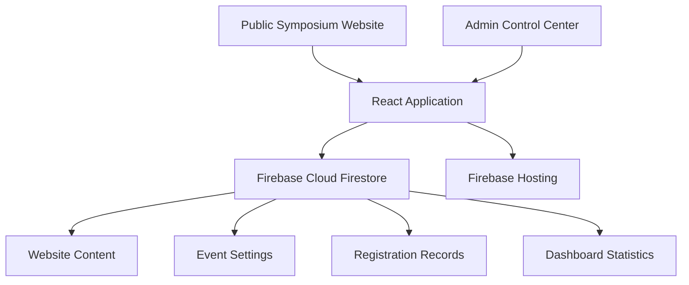

# ⚡ DYNAMOZ'26
### THINK. BUILD. INNOVATE.

<p align="center">
  
</p>

<p align="center">
  <strong>A Digital Symposium Experience</strong>
  <br />
  Department of Computer Science and Engineering
  <br />
  University College of Engineering, Nagercoil
</p>

<p align="center">
  <a href="https://dynamoz-26.web.app">🌐 Live Website</a> ·
  <a href="https://github.com/Saheera-006/dynamoz26">💻 Source Code</a>
</p>

<p align="center">
  
  
  
  
</p>

---

## ◈ Project Overview

**DYNAMOZ'26** is a web-based college symposium platform developed for the Department of Computer Science and Engineering at University College of Engineering, Nagercoil.

Designed to bring symposium information and event registrations into one digital space, the platform combines a public-facing website with a dedicated administrative control center.

Beyond displaying event information, DYNAMOZ'26 includes an admin dashboard for monitoring registrations, managing event settings, and updating public website content without manually editing the source code for every content change.

> **One platform. Multiple events. Centralized control.**

## ✦ Key Features

### 01 — Public Symposium Website

- Dedicated symposium landing page.
- Customizable hero section with title, year, welcome text, and taglines.
- About section highlighting the department and institution.
- Event information and registration experience.
- Staff and team profile display.
- Contact information and student coordinator details.
- Social and WhatsApp link support.

### 02 — Administrative Control Center

A dedicated admin interface for managing symposium operations from one place.

- **Dashboard Overview** — View registration statistics, active event counts, registration status, and recent activity.
- **Registration Analytics** — Monitor registration counts across technical and non-technical events.
- **Registration Management** — Review submitted registration records and track registrations.
- **Event Management** — Manage event information and related settings.
- **Registration Controls** — Enable or disable registrations and monitor registration deadlines.
- **Website Editor** — Update public-facing website content through editable fields.
- **Team Management** — Add, update, or remove staff and team profiles.
- **Image Uploads** — Manage staff profile photos through the website editor.
- **Coordinator Management** — Add or remove student coordinator details.
- **Contact Management** — Update department contact information and location.
- **Social Link Management** — Configure the WhatsApp link displayed on the website.

### 03 — Dynamic Website Content

The website editor allows administrators to manage:

| Section | Editable Content |
| --- | --- |
| Hero | Welcome text, main title, year, taglines |
| Event Settings | Event date, registration deadline, registration availability |
| About | Subtitle, lead content, description |
| People & Team | Names, roles, initials, descriptions, photos |
| Contact | Department, institution, email, location |
| Coordinators | Student names and phone numbers |
| Social Links | WhatsApp URL |

Changes are saved automatically through the editor, and updated content is reflected on the public website.

### 04 — Registration Monitoring

The dashboard provides a consolidated view of symposium registration activity, including:

- Total registration count.
- Registration availability and deadline status.
- Registration counts by event.
- Recent registration activity.
- Registration identifiers and submitted registration details.

This helps administrators monitor participation and manage registrations from a centralized interface.

---

## ◈ Technology Stack

| Technology | Purpose |
| --- | --- |
| React.js | Building the interactive frontend |
| JavaScript | Application logic and interactions |
| npm | Dependency management and development scripts |
| Firebase Cloud Firestore | Storing and retrieving application data |
| Firebase Hosting | Deploying the public website |

---

## ◈ System Architecture



The React application provides the public website and administrative interface. Cloud Firestore stores application data, while Firebase Hosting serves the deployed website.

*Note: The diagram represents the high-level architecture; the exact data flow depends on the implementation.*

---

## ◈ Getting Started

Follow these steps to run the project locally.

### Prerequisites

Make sure you have installed:

- [Node.js](https://nodejs.org/)
- npm, included with Node.js
- Access to the Firebase project and the required configuration

### 1. Clone the Repository

```bash
git clone https://github.com/Saheera-006/dynamoz26.git
```

### 2. Navigate to the Project Directory

```bash
cd dynamoz26
```

### 3. Install Dependencies

```bash
npm install
```

### 4. Configure Firebase

Configure the Firebase connection using the project's expected configuration and your authorized Firebase project credentials.

**Security note:** Never commit private credentials, service-account keys, or sensitive environment variables to a public repository.

### 5. Start the Development Server

```bash
npm run dev
```

Open the local development URL displayed in your terminal.

---

## ◈ Deployment

The public symposium website is deployed using **Firebase Hosting**.

Live URL: [https://dynamoz-26.web.app](https://dynamoz-26.web.app)

To deploy a new version, use the Firebase deployment workflow configured for the project. For a typical Vite application, the commands may look like this:

```bash
npm run build
firebase deploy --only hosting
```

Make sure the Firebase CLI is installed, you are signed in, and the correct Firebase project is selected before deployment. The build command and output directory should match the project's actual configuration.

---

## ◈ Project Highlights

- A public website connected to a cloud-hosted database.
- A dedicated admin control center for symposium operations.
- Dynamic website content editing without changing source files for routine updates.
- Centralized registration monitoring and event-wise statistics.
- Firebase-based deployment for public access.
- A single platform designed for both participants and administrators.

---

## ◈ Future Enhancements

Potential improvements for future versions include:

- Enhanced admin authentication and role-based permissions.
- Advanced registration filters, search, and export options.
- Improved analytics and downloadable reports.
- More detailed registration validation and duplicate detection.
- Accessibility improvements and performance optimization.
- Additional safeguards for sensitive registration data.

---

## ◈ Institution

**Department of Computer Science and Engineering**  
University College of Engineering, Nagercoil  
Tamil Nadu, India

---

## ◈ Developer

**Fathima Saheera J**  
Full Stack Web Developer — Aspiring

- **GitHub:** [Saheera-006](https://github.com/Saheera-006)
- **Project Repository:** [DYNAMOZ'26](https://github.com/Saheera-006/dynamoz26)
- **Live Website:** [dynamoz-26.web.app](https://dynamoz-26.web.app)

---

<p align="center">
  <strong>DYNAMOZ'26</strong>
  <br />
  <em>Turning ideas into experiences.</em>
  <br /><br />
  Built with dedication for the CSE symposium at University College of Engineering, Nagercoil.
</p>
