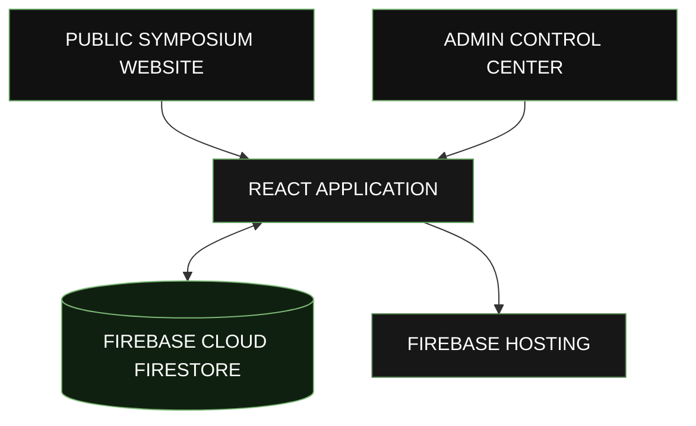

<!-- =====================================================
     DYNAMOZ'26 | OFFICIAL PROJECT README
     Theme: Dark Cyberpunk / Sage Green
====================================================== -->

<div align="center">


# <span>DYNAMOZ'26</span>


**A Digital Symposium Experience**

Department of Computer Science and Engineering  
University College of Engineering, Nagercoil

<br/>

<a href="https://dynamoz-26.web.app">
  
</a>
<a href="https://github.com/Saheera-006/dynamoz26">
  
</a>

<br/><br/>


</div>

---

## `01 / THE PROJECT`

**DYNAMOZ'26** is a web-based symposium platform developed for the Department of Computer Science and Engineering at University College of Engineering, Nagercoil.

Built with React and Firebase, the platform brings symposium information, event registrations, and administrative operations together in one place.

The project features a public-facing symposium website and a dedicated **Admin Control Center**, allowing administrators to monitor registrations, manage event settings, and update website content through an interactive editor.

> **One symposium. One digital platform. Complete control.**

<div align="center">

**DYNAMOZ'26 — WHERE IDEAS MEET INNOVATION**

</div>

---

## `02 / CORE FEATURES`

### ◈ PUBLIC SYMPOSIUM WEBSITE

- Dedicated symposium landing page.
- Customizable hero section with welcome text, title, year, and taglines.
- About section for symposium and institutional information.
- Event information and participant registration.
- Staff and team profile display.
- Department contact details and location.
- Student coordinator information.
- Configurable WhatsApp and social links.

### ◈ ADMIN CONTROL CENTER

A dedicated dashboard for managing symposium information and monitoring registrations.

| Module | Capabilities |
|:--|:--|
| **Dashboard** | Registration statistics, active event count, registration status, recent activity |
| **Website Editor** | Update hero content, About section, and public-facing website information |
| **Event Management** | Manage event information and registration settings |
| **Registrations** | View registration records and monitor participant activity |
| **Event Analytics** | View registration counts across individual events |
| **Team Management** | Add, edit, or remove staff and team profiles |
| **Image Management** | Upload, change, or remove staff photos |
| **Coordinator Management** | Maintain student coordinator names and phone numbers |
| **Contact Settings** | Edit department, institution, email, and location |
| **Social Links** | Configure the WhatsApp URL displayed on the public website |

### ◈ DYNAMIC WEBSITE EDITOR

The admin website editor allows authorized administrators to modify website content without manually changing source code for routine content updates.

**Editable sections include:**

- Hero section — welcome text, main title, year, and taglines.
- Event settings — event date, registration deadline, and registration availability.
- About section — subtitle, lead content, and description.
- People and team — names, roles, initials, descriptions, and staff photos.
- Contact information — department, institution, email, and location.
- Student coordinators — names and contact numbers.
- Social links — WhatsApp URL.

Changes are saved automatically through the editor and reflected on the public website.

### ◈ REGISTRATION ANALYTICS

The administrative dashboard brings registration activity into a consolidated view.

- Total registration count.
- Active event count.
- Registration status and deadline information.
- Event-wise registration statistics.
- Latest registration activity.
- Registration IDs and submitted participant information.

These features help administrators monitor symposium participation and manage event registration activity from one interface.

---

## `03 / TECHNOLOGY STACK`

<div align="center">

| TECHNOLOGY | ROLE |
|:--|:--|
| **React.js** | Interactive frontend |
| **JavaScript** | Application logic and interactions |
| **npm** | Dependency management and development scripts |
| **Firebase Cloud Firestore** | Cloud database |
| **Firebase Hosting** | Website deployment and hosting |

</div>

---

## `04 / SYSTEM ARCHITECTURE`



The React application powers the public website and admin interface. Firebase Cloud Firestore stores application data, while Firebase Hosting serves the deployed website.

*The diagram represents the high-level architecture. The actual data flow depends on the project's implementation.*

---

## `05 / GETTING STARTED`

Follow the steps below to run DYNAMOZ'26 locally.

### Prerequisites

- [Node.js](https://nodejs.org/)
- npm
- Access to the required Firebase project and configuration

### Step 01 — Clone the Repository

```bash
git clone https://github.com/Saheera-006/dynamoz26.git
```

### Step 02 — Navigate to the Project

```bash
cd dynamoz26
```

### Step 03 — Install Dependencies

```bash
npm install
```

### Step 04 — Configure Firebase

Set up the Firebase configuration required by the application.

Ensure that the project is connected to the correct Firebase project and that the required Cloud Firestore access is configured.

**Security:** Never commit private credentials, service-account keys, or sensitive environment variables to a public repository.

### Step 05 — Start the Development Server

```bash
npm run dev
```

Open the local development URL displayed in your terminal.

---

## `06 / DEPLOYMENT`

DYNAMOZ'26 is hosted on **Firebase Hosting**.

<div align="center">

### LIVE DEPLOYMENT

<a href="https://dynamoz-26.web.app">
  
</a>

<br/>

https://dynamoz-26.web.app

</div>

For a typical Vite project using Firebase Hosting, the deployment workflow may look like this:

```bash
npm run build
firebase deploy --only hosting
```

Make sure the Firebase CLI is installed, you are authenticated, and the correct Firebase project and hosting configuration are selected before deployment.

---

## `07 / PROJECT HIGHLIGHTS`

- **Unified Platform** — Symposium information and registration in one digital destination.
- **Cloud Database** — Application data managed using Firebase Cloud Firestore.
- **Centralized Administration** — Dedicated control center for symposium operations.
- **Dynamic Content Management** — Update website information through the admin editor.
- **Registration Monitoring** — View registration statistics and recent activity.
- **Cloud Deployment** — Public website hosted using Firebase Hosting.

---

## `08 / FUTURE ENHANCEMENTS`

Potential improvements for future versions:

- Enhanced role-based access control for administrative features.
- Advanced registration search, filtering, and reporting.
- Downloadable registration and analytics reports.
- Improved duplicate-registration detection and validation.
- Additional accessibility and performance improvements.
- Expanded dashboard insights and participation analytics.

---

## `09 / INSTITUTION`

<div align="center">

**DEPARTMENT OF COMPUTER SCIENCE AND ENGINEERING**

University College of Engineering, Nagercoil  
Tamil Nadu, India

</div>

---

## `10 / DEVELOPER`

<div align="center">

### FATHIMA SAHEERA J

*Aspiring Full Stack Developer*

<a href="https://github.com/Saheera-006">
  
</a>

<a href="https://dynamoz-26.web.app">
  
</a>

</div>

---

<div align="center">


### DYNAMOZ'26

**DARK. BOLD. INNOVATIVE.**

<sub>Built with dedication for the CSE symposium at University College of Engineering, Nagercoil.</sub>

<br/>

<sub>© 2026 DYNAMOZ'26 · All rights reserved to their respective owners.</sub>

</div>
